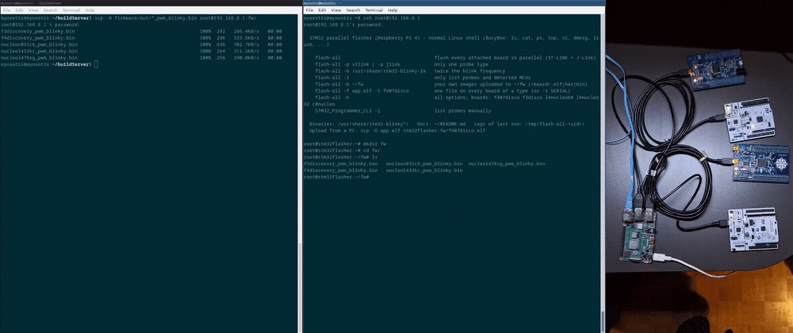

# rpi-flash-server — parallel STM32 flasher on a Raspberry Pi 4

## Overview

A small Buildroot Linux image for the **Raspberry Pi 4 Model B** that turns
the Pi into a flashing station for STM32 boards. Every board is connected to
the Pi over USB through its ST-LINK (or a SEGGER J-Link probe); you log in over
SSH, copy your firmware to the Pi with `scp` and program the boards with the
native **STM32CubeProgrammer** command-line tool, `STM32_Programmer_CLI`, one
at a time or all at once.


What is in the image:

| Part | Details |
|---|---|
| STM32CubeProgrammer | v2.23.0 Linux ARM64 CLI, `STM32_Programmer_CLI` (on `PATH`, installed in `/opt/stm32cubeprog`) |
| Probes | ST-LINK/V2, V2-1, V3 and SEGGER J-Link (both through STM32CubeProgrammer) |
| `flash-all` | optional shell wrapper (`/usr/bin/flash-all`) that runs `STM32_Programmer_CLI` for every attached board in parallel and picks the right image per board by its device ID |
| Demo firmware | a "breathing LED" blinky for each board below, same rhythm on all of them: `/usr/share/stm32-blinky/` (2 s period) and `/usr/share/stm32-blinky-2x/` (1 s) |
| System | mainline Linux 6.12, glibc, BusyBox shell and tools, dropbear SSH; Pi firmware pinned to a fixed commit |
| Network | `192.168.8.1` on the Ethernet port with a small DHCP server that hands out no gateway and no DNS, so a PC cabled to it keeps its own internet connection |

Tested with one board per USB port:

| Board | MCU | Device ID | LED | Demo binary |
|---|---|---|---|---|
| STM32F407G-DISC1 (F4 Discovery) | STM32F407VG | 0x413 | LD4 green, PD12 (TIM4_CH1) | `f4discovery_pwm_blinky.bin` |
| STM32F3DISCOVERY | STM32F303VC | 0x422 | LD7 green, PE11 (TIM1_CH2) | `f3discovery_pwm_blinky.bin` |
| NUCLEO-L476RG | STM32L476RG | 0x415 | LD2 green, PA5 (TIM2_CH1) | `nucleol476rg_pwm_blinky.bin` |
| NUCLEO-C031C6 | STM32C031C6 | 0x453 | LD4 green, PA5 (TIM3) | `nucleoc031c6_pwm_blinky.bin` |

`STM32_Programmer_CLI` itself works with any STM32 it supports. `flash-all`
also recognises STM32L45x/L46x (0x462), L41x–L44x Nucleo-32 boards (0x464,
0x435) and other C0 parts (0x493, 0x44C, 0x44D), untested.

---

## Building the image

You don't have to build anything: a ready image is attached to every
[release](https://github.com/martincvitic19/rpi-flash-server/releases)
(`stm32flasher-rpi4-sdcard.img.xz` + `.bmap`). Skip to
[Flashing the image](#flashing-the-image) if you use that.

### Requirements

- Linux x86-64 PC, ~15 GB free disk, a few GB RAM. The first build takes
  about 1.5 h on 6 cores.
- Buildroot host packages. On Debian/Ubuntu:
  ```sh
  sudo apt install build-essential git rsync bc cpio unzip file wget curl python3 \
       libncurses-dev xz-utils gcc-arm-none-eabi
  ```
  `gcc-arm-none-eabi` builds the demo firmware. If it is missing, `make`
  builds an ARM toolchain into `armgcc/` with `tools/build-arm-toolchain.sh`
  (about 15 min, once).
- **STM32CubeProgrammer 2.23.0 for Linux ARM64.** ST's download needs a free
  myST login, so it is not fetched automatically. Download *STM32CubeProgrammer
  — Linux ARM64* from
  <https://www.st.com/en/development-tools/stm32cubeprog.html> and save it as
  `dl/cubeprog/stm32cubeprogrammer_2.23.0_arm64.deb.zip`. Its SHA-256 is
  checked during the build.

### Build

```sh
git clone https://github.com/martincvitic19/rpi-flash-server.git && cd rpi-flash-server
mkdir -p dl/cubeprog && cp ~/Downloads/stm32cubeprogrammer_2.23.0_arm64.deb.zip dl/cubeprog/
# optional: your SSH public key for root and the stm32 user
mkdir -p keys && cat ~/.ssh/id_ed25519.pub > keys/authorized_keys
make
```

`make` downloads Buildroot 2026.02.3 LTS (the repository is a Buildroot
`BR2_EXTERNAL` tree, not a fork), builds the demo firmware and then the image:
`output/images/sdcard.img` and `output/images/sdcard.img.bmap`.

| Target | What it does |
|---|---|
| `make` | firmware + image |
| `make firmware` | only the demo binaries (`firmware/out/`, `firmware/out-2x/`) |
| `make menuconfig` | Buildroot configuration; then `make savedefconfig` to store it |
| `make clean` / `make distclean` | remove build output / also Buildroot and the local toolchain |

After changing only the overlay (e.g. `flash-all`) or the firmware, `make`
takes about a minute.

### Repository layout

```
Makefile                         top level: downloads Buildroot, builds firmware + image
br2-stm32flasher/                Buildroot external tree
  configs/rpi4_stm32flasher_defconfig
  board/rpi4/                    config.txt, cmdline.txt, genimage.cfg, kernel fragment,
                                 post-build/post-image scripts, users
    overlay/                     files copied into the root filesystem (flash-all, network, banner)
  package/stm32cubeprog/         installs ST's .deb into /opt/stm32cubeprog
  package/rpi4-bootfw/           Pi 4 GPU firmware, pinned commit + hashes
firmware/                        demo blinky (blinky.c, link.ld, Makefile)
tools/build-arm-toolchain.sh     builds arm-none-eabi-gcc if none is installed
```

---

## Flashing the image

Write the image to a micro-SD card (8 GB or larger) with
[bmaptool](https://github.com/yoctoproject/bmaptool). It writes only the used
blocks (about 250 MB of the 1.1 GB image) and verifies them.

```sh
sudo apt install bmap-tools
lsblk                        # find the SD card, e.g. /dev/sdX or /dev/mmcblk0
```

Release image:

```sh
sudo bmaptool copy --bmap stm32flasher-rpi4-sdcard.img.bmap \
     stm32flasher-rpi4-sdcard.img.xz /dev/sdX
```

Self-built image:

```sh
sudo bmaptool copy output/images/sdcard.img /dev/sdX
```

Double-check the device name: everything on it is overwritten. Put the card in
the Pi, connect the boards over USB and the Pi's Ethernet port to your PC, and
power it on. It is reachable after about 20 s.

### Accessing Raspberry Pi over SSH

The Pi is at **192.168.8.1**. Cabled straight to a PC, it gives the PC an
address in 192.168.8.100–150 by DHCP. No gateway and no DNS are handed out, so
the PC's internet connection is not affected. On a LAN with its own DHCP
server, the Pi takes a lease from it and keeps 192.168.8.1 as a second address.

```sh
ssh root@192.168.8.1         # password: stm32
ssh stm32@192.168.8.1        # unprivileged user, password: stm32, can use the probes too
```

If you built the image with `keys/authorized_keys`, key login works for both
users. After re-flashing the card the host key changes:
`ssh-keygen -R 192.168.8.1`. The HDMI console (tty1) accepts the same logins.

To make sure the Pi link can never take over your PC's default route or DNS,
use a static NetworkManager profile instead of DHCP:

```sh
nmcli connection add type ethernet con-name rpi-link ifname <usb-eth-iface> \
  ipv4.method manual ipv4.addresses 192.168.8.2/24 ipv4.never-default yes \
  ipv4.ignore-auto-dns yes ipv6.method link-local
```

The shell is BusyBox (`ls`, `cat`, `vi`, `ps`, `dmesg`, `lsusb`, …).

### Transferring binaries to be flashed using scp

The demo firmware is built on the PC into `firmware/out/` (2 s breathing
period) and `firmware/out-2x/` (1 s), one PWM blinky per board:

| Board | Binary |
|---|---|
| STM32F407G-DISC1 | `f4discovery_pwm_blinky.bin` |
| STM32F3DISCOVERY | `f3discovery_pwm_blinky.bin` |
| NUCLEO-L476RG | `nucleol476rg_pwm_blinky.bin` |
| NUCLEO-C031C6 | `nucleoc031c6_pwm_blinky.bin` |
| NUCLEO-L432KC (untested) | `nucleol432kc_pwm_blinky.bin` |

(`.elf` files with the same names are next to them. To get the binaries
without building the image: `make firmware`.)

Copy them to the Pi. The Pi runs dropbear, which has no SFTP server, so use
`scp -O` (the classic scp protocol; recent OpenSSH uses SFTP by default):

```sh
ssh root@192.168.8.1 mkdir -p fw
scp -O firmware/out/*_pwm_blinky.bin root@192.168.8.1:fw/
```

Check on the Pi that they arrived:

```sh
ssh root@192.168.8.1
ls -l fw/
```

`STM32_Programmer_CLI` takes `.elf`, `.hex`, `.srec` and `.bin` files. The
root filesystem is writable, so files in `~/fw` stay there across reboots.

### Probing connected devices

Each board is identified by the serial number of its probe (the ST-LINK on a
Nucleo/Discovery board, or the J-Link). It is not printed on the board; read it
on the Pi:

```sh
STM32_Programmer_CLI -l                  # all probes
STM32_Programmer_CLI -l stlink-only      # "ST-LINK SN : 066BFF575377524867071643"
STM32_Programmer_CLI -l jlink-only
cat /sys/bus/usb/devices/*/serial        # same serials, straight from USB
```

To see which MCU is behind a probe, connect to it. The output shows
`Device ID`, `Device name` and the flash size:

```sh
STM32_Programmer_CLI -c port=SWD sn=066BFF575377524867071643 mode=UR
STM32_Programmer_CLI -c port=JLINK sn=<J-Link SN>
```

`flash-all -l` does all of this in one go and prints probe type, serial,
device ID, board and the image it would flash:

```
[stlink 066BFF575377524867071643] 0x413 STM32F405/407 (F4 Discovery, LD4 green PD12) -> /usr/share/stm32-blinky/f4discovery_pwm_blinky.bin
[stlink 066CFF494877514867173517] 0x422 STM32F303xB/C (F3 Discovery, LD7 green PE11) -> /usr/share/stm32-blinky/f3discovery_pwm_blinky.bin
```

With two identical boards, unplug one and run `STM32_Programmer_CLI -l` again
to see which serial belongs to which board.

### Flashing individual images to devices

With `STM32_Programmer_CLI`: `-c` selects the probe by its serial, `-d`
downloads, `-v` verifies and `-rst` resets the MCU so the new firmware starts.
`mode=UR` connects under reset, which works even if the running firmware
disabled SWD. A `.bin` needs the flash address after it (`0x08000000` on all
these boards); `.elf`, `.hex` and `.srec` carry their own addresses.

```sh
STM32_Programmer_CLI -c port=SWD sn=066BFF575377524867071643 mode=UR -d fw/f4discovery_pwm_blinky.bin 0x08000000 -v -rst
```

The output ends with `Download verified successfully` and the board's LED
starts breathing. The same for the other boards (use your serials from
`STM32_Programmer_CLI -l`):

```sh
STM32_Programmer_CLI -c port=SWD sn=066CFF494877514867173517 mode=UR -d fw/f3discovery_pwm_blinky.bin 0x08000000 -v -rst
STM32_Programmer_CLI -c port=SWD sn=066EFF3234584D3043012451 mode=UR -d fw/nucleol476rg_pwm_blinky.bin 0x08000000 -v -rst
STM32_Programmer_CLI -c port=SWD sn=066EFF35314B4E3043195329 mode=UR -d fw/nucleoc031c6_pwm_blinky.bin 0x08000000 -v -rst
```

With a J-Link instead of an ST-LINK: `-c port=JLINK sn=<J-Link SN>`.

Other useful commands:

```sh
STM32_Programmer_CLI -c port=SWD sn=<SN> mode=UR -e all                         # full chip erase
STM32_Programmer_CLI -c port=SWD sn=<SN> mode=UR -r32 0x08000000 0x100          # read memory
STM32_Programmer_CLI -c port=SWD sn=<SN> mode=UR -u dump.bin 0x08000000 0x4000  # save flash to a file
STM32_Programmer_CLI -c port=SWD sn=<SN> mode=UR -ob displ                      # option bytes
STM32_Programmer_CLI --help
```

The same with `flash-all`:

```sh
flash-all -f fw/f4discovery_pwm_blinky.bin -s 066BFF575377524867071643   # one probe
flash-all -f fw/f4discovery_pwm_blinky.bin -t f4discovery                # every board of that type
```

Board names: `f4discovery`, `f3discovery`, `nucleol476rg`, `nucleol432kc`,
`nucleoc031c6`.

### Flashing all connected devices

`STM32_Programmer_CLI` handles one probe per process, so start one per board
in the background and wait for all of them:

```sh
cd ~/fw
STM32_Programmer_CLI -c port=SWD sn=066BFF575377524867071643 mode=UR -d f4discovery_pwm_blinky.bin 0x08000000 -v -rst > f4.log 2>&1 &
STM32_Programmer_CLI -c port=SWD sn=066CFF494877514867173517 mode=UR -d f3discovery_pwm_blinky.bin 0x08000000 -v -rst > f3.log 2>&1 &
STM32_Programmer_CLI -c port=SWD sn=066EFF3234584D3043012451 mode=UR -d nucleol476rg_pwm_blinky.bin 0x08000000 -v -rst > l4.log 2>&1 &
STM32_Programmer_CLI -c port=SWD sn=066EFF35314B4E3043195329 mode=UR -d nucleoc031c6_pwm_blinky.bin 0x08000000 -v -rst > c0.log 2>&1 &
wait; grep -c "verified successfully" *.log
```

All LEDs then breathe with the same rhythm.

`flash-all` does the same without typing serials: it finds every probe, reads
each MCU's device ID, picks the matching image, starts all downloads at once,
shows each board's progress prefixed with its name and ends with a summary.
The exit code is non-zero if any board failed; logs are in
`/tmp/flash-all-<uid>/<serial>.log`.

```sh
flash-all -b fw                            # the binaries you copied to ~/fw
flash-all                                  # demo blinky built into the image
flash-all -b /usr/share/stm32-blinky-2x    # demo blinky, twice the frequency
flash-all -p stlink                        # only ST-LINK probes (or -p jlink)
flash-all -h                               # all options
```

```
[stlink 066CFF494877514867173517] 0x422 STM32F303xB/C (F3 Discovery, LD7 green PE11) -> /root/fw/f3discovery_pwm_blinky.bin
[stlink 066EFF35314B4E3043195329] 0x453 STM32C0 (Nucleo, LED PA5) -> /root/fw/nucleoc031c6_pwm_blinky.bin
[stlink 066BFF575377524867071643] 0x413 STM32F405/407 (F4 Discovery, LD4 green PD12) -> /root/fw/f4discovery_pwm_blinky.bin
[stlink 066EFF3234584D3043012451] 0x415 STM32L47x/L48x (Nucleo-64, LD2 PA5) -> /root/fw/nucleol476rg_pwm_blinky.bin
Flashing 4 board(s) in parallel...
[f4discovery] Download verified successfully
...
===== summary =====
f4discovery  stlink  066BFF575377524867071643  f4discovery_pwm_blinky.bin     OK
f3discovery  stlink  066CFF494877514867173517  f3discovery_pwm_blinky.bin     OK
nucleol476rg stlink  066EFF3234584D3043012451  nucleol476rg_pwm_blinky.bin    OK
nucleoc031c6 stlink  066EFF35314B4E3043195329  nucleoc031c6_pwm_blinky.bin    OK
```

With `-b DIR`, each board gets the first match of `DIR/<probe serial>.<ext>`,
`DIR/<board>.<ext>` or `DIR/<board>_pwm_blinky.<ext>` (ext = `elf`, `hex`,
`srec` or `bin`). Boards without a match are skipped, and so is a board whose
name exists in more than one format. `.bin` files go to `0x08000000` (change
with `-a ADDR`).

If a board shows `unknown or unreachable target`, check its USB cable and
jumpers (Nucleo: both CN2 jumpers on). `No ST-LINK/J-Link probes found` means
`lsusb` on the Pi shows no `0483:374x` (ST-LINK) or `1366:xxxx` (J-Link) device.

---

## Demo

Left: the PC copies the PWM blinky binaries to the Pi with `scp -O` and, over
SSH, flashes all four boards in parallel. Right: the boards start breathing.
Click the animation for the full video (41 s).

[](docs/demo.mp4)

---

## License

The code in this repository (Buildroot external tree, scripts, demo firmware)
is released under the [MIT No Attribution](LICENSE) license (MIT-0): use it
for anything, no attribution required.

The image built from it contains third-party software under its own licenses:

- **Buildroot**, **Linux**, **BusyBox**: GPL-2.0. **glibc**: LGPL-2.1+.
  **dropbear**: MIT-style. `make -C output legal-info` collects all license
  texts and sources of a build.
- **Raspberry Pi boot firmware** (`start4.elf`, `fixup4.dat`): Broadcom's
  redistributable binary license.
- **STM32CubeProgrammer**: © STMicroelectronics, license **SLA0048**. Binary
  redistribution is allowed only under its conditions (keep the copyright
  notice and license, use only with ST devices). The package is not part of
  this repository. In the image its license is
  `/opt/stm32cubeprog/bin/doc/license.txt`.
- **SEGGER J-Link library** (`libjlinkarm.so`, bundled by ST in
  STM32CubeProgrammer): SEGGER's license,
  `/opt/stm32cubeprog/bin/doc/License_Segger_JLink.txt` in the image.
