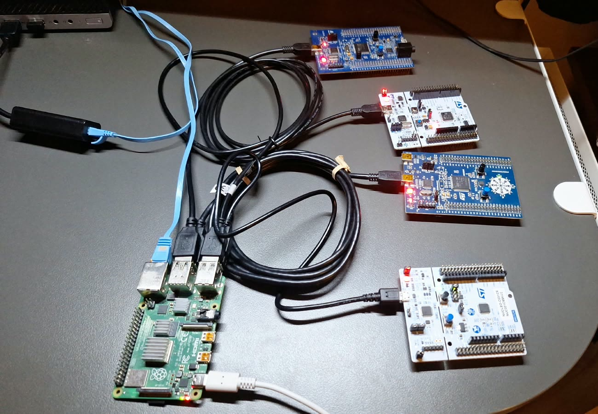

# rpi-flash-server — flash multiple STM32 devices simultaneously

## Overview

A small Buildroot Linux image for the **Raspberry Pi 4 Model B** that turns
the Pi into a flashing station for STM32 boards. This image was built specifically for flashing STM32 boards: every board is connected to
the Pi over USB and flashed through its ST-LINK or a SEGGER J-Link probe.

To flash connected devices to Raspberry Pi running this image you simply log into the device via SSH, copy your firmware to the Pi with `scp` and then flash the devices using native **STM32CubeProgrammer** over the command line `STM32_Programmer_CLI`, one at a time or all at once using a convenience wrapper script called `flash-all` which currently supports flashing MCUs in families shown in the picture below (STM32F407G-DISC1, STM32F3DISCOVERY, NUCLEO-L476RG and NUCLEO-C031C6) which was good enough for me for demo purposes.



---

## Building the image

You can either build the image yourself using Buildroot and configuring the build according to your needs or you can choose to download a precompiled image in the
[release](https://github.com/martincvitic19/rpi-flash-server/releases)
(`stm32flasher-rpi4-sdcard.img.xz` + `.bmap`). If you only want to obtain the image to write it to an SD card, I recommend you to do so. In that case, download .bmap and .xz files and skip to [Flashing the image](#flashing-the-image).

### Requirements

- Linux x86-64 PC, ~15 GB free disk, a few GB RAM. The first build will take at least a couple of hours (might be less depending on the hardware you build it on).
- Buildroot host packages. On Debian/Ubuntu:
  ```sh
  sudo apt install build-essential git rsync bc cpio unzip file wget curl python3 \
       libncurses-dev xz-utils
  ```
- **STM32CubeProgrammer 2.23.0 for Linux ARM64.** ST's download needs a free
  myST login, so it is not fetched automatically. Download *STM32CubeProgrammer
  — Linux ARM64* from
  <https://www.st.com/en/development-tools/stm32cubeprog.html> and save it as
  `dl/cubeprog/stm32cubeprogrammer_2.23.0_arm64.deb.zip` (21677359 bytes).
  `make` checks its SHA-256 before it starts building and stops if it does
  not match. A failed download in the browser can leave a tiny file under the
  same name, with the real one saved as `...deb(1).zip` or similar; check with:
  ```sh
  sha256sum dl/cubeprog/stm32cubeprogrammer_2.23.0_arm64.deb.zip
  # 99d2a1bfd8948f713ccae814b3038528d6a4e76e9d9d101857692a4d8da5de6f
  ```

### Build

```sh
git clone https://github.com/martincvitic19/rpi-flash-server.git && cd rpi-flash-server
mkdir -p dl/cubeprog && cp ~/Downloads/stm32cubeprogrammer_2.23.0_arm64.deb.zip dl/cubeprog/
# optional: your SSH public key for root and the stm32 user
mkdir -p keys && cat ~/.ssh/id_ed25519.pub > keys/authorized_keys
make
```

`make` downloads Buildroot 2026.02.3 LTS (the repository is a Buildroot
`BR2_EXTERNAL` tree, not a fork) and builds the image:
`output/images/sdcard.img` and `output/images/sdcard.img.bmap`.

| Target | What it does |
|---|---|
| `make` | the image |
| `make menuconfig` | Buildroot configuration; then `make savedefconfig` to store it |
| `make clean` / `make distclean` | remove build output / also the unpacked Buildroot |

After changing only the overlay (e.g. `flash-all`), `make` takes about a
minute.

### Repository layout

```
Makefile                         top level: downloads Buildroot, builds the image
br2-stm32flasher/                Buildroot external tree
  configs/rpi4_stm32flasher_defconfig
  board/rpi4/                    config.txt, cmdline.txt, genimage.cfg, kernel fragment,
                                 post-build/post-image scripts, users
    overlay/                     files copied into the root filesystem (flash-all, network, banner)
  package/stm32cubeprog/         installs ST's .deb into /opt/stm32cubeprog
  package/rpi4-bootfw/           Pi 4 GPU firmware, pinned commit + hashes
```

---

## Flashing the image

Write the image to a micro-SD card (8 GB or larger) with
[bmaptool](https://github.com/yoctoproject/bmaptool). It writes only the used
blocks (about 250 MB of the 1.1 GB image) and verifies them.

```sh
sudo apt install bmap-tools
lsblk                        # find the SD card, e.g. /dev/sdX or /dev/mmcblk0
```

Release image:

```sh
sudo bmaptool copy --bmap stm32flasher-rpi4-sdcard.img.bmap \
     stm32flasher-rpi4-sdcard.img.xz /dev/sdX
```

Self-built image:

```sh
sudo bmaptool copy output/images/sdcard.img /dev/sdX
```

Double-check the device name: everything on it is overwritten. Put the card in
the Pi, connect the boards over USB and the Pi's Ethernet port to your PC, and
power it on. It is reachable after about 20 s.

### Accessing Raspberry Pi over SSH

The Pi is at **192.168.8.1**. Cabled straight to a PC, it gives the PC an
address in 192.168.8.100–150 by DHCP. No gateway and no DNS are handed out, so
the PC's internet connection is not affected. On a LAN with its own DHCP
server, the Pi takes a lease from it and keeps 192.168.8.1 as a second address.

```sh
ssh root@192.168.8.1         # password: stm32
ssh stm32@192.168.8.1        # unprivileged user, password: stm32, can use the probes too
```

If you built the image with `keys/authorized_keys`, key login works for both
users. After re-flashing the card the host key changes:
`ssh-keygen -R 192.168.8.1`. The HDMI console (tty1) accepts the same logins.

To make sure the Pi link can never take over your PC's default route or DNS,
use a static NetworkManager profile instead of DHCP:

```sh
nmcli connection add type ethernet con-name rpi-link ifname <usb-eth-iface> \
  ipv4.method manual ipv4.addresses 192.168.8.2/24 ipv4.never-default yes \
  ipv4.ignore-auto-dns yes ipv6.method link-local
```

The shell is BusyBox (`ls`, `cat`, `vi`, `ps`, `dmesg`, `lsusb`, …).

### Transferring binaries to be flashed using scp

Copy your binaries to the Pi using `scp`. The Pi runs `dropbear`, which has no SFTP server, so use
`scp -O` (the classic scp protocol; recent OpenSSH uses SFTP by default):

```sh
ssh root@192.168.8.1 mkdir fw
scp -O <path_to_your_binary> root@192.168.8.1:fw/
```

Check on the Pi that they arrived:

```sh
ssh root@192.168.8.1
ls fw/
```

`STM32_Programmer_CLI` takes `.elf`, `.hex`, `.srec` and `.bin` files. The
root filesystem is writable, so files in `~/fw` stay there across reboots.

### Probing connected devices

Each board is identified by the serial number of its probe (the ST-LINK on a
Nucleo/Discovery board, or the J-Link). It is not printed on the board; read it
on the Pi:

```sh
STM32_Programmer_CLI -l                  # all probes
STM32_Programmer_CLI -l stlink-only      # "ST-LINK SN : 066BFF575377524867071643"
STM32_Programmer_CLI -l jlink-only
cat /sys/bus/usb/devices/*/serial        # same serials, straight from USB
```

`flash-all -l` does all of this in one go and prints probe type, serial,
device ID, board and the image it would flash:

```
[stlink 066BFF575377524867071643] 0x413 STM32F405/407 (F4 Discovery, LD4 green PD12) -> /root/fw/f4discovery.bin
[stlink 066CFF494877514867173517] 0x422 STM32F303xB/C (F3 Discovery, LD7 green PE11) -> /root/fw/f3discovery.bin
```

With two identical boards, unplug one and run `STM32_Programmer_CLI -l` again
to see which serial belongs to which board.

### Flashing individual images to devices

With `STM32_Programmer_CLI`: `-c` selects the probe by its serial, `-d`
downloads, `-v` verifies and `-rst` resets the MCU so the new firmware starts.
`mode=UR` connects under reset, which works even if the running firmware
disabled SWD. A `.bin` needs the flash address after it (`0x08000000` on all
these boards); `.elf`, `.hex` and `.srec` carry their own addresses.

```sh
STM32_Programmer_CLI -c port=SWD sn=066BFF575377524867071643 mode=UR -d fw/f4_app.bin 0x08000000 -v -rst
```

The output ends with `Download verified successfully`. The same for the other boards (use your serial numbers from `STM32_Programmer_CLI -l`):

```sh
STM32_Programmer_CLI -c port=SWD sn=066CFF494877514867173517 mode=UR -d fw/f3_app.bin 0x08000000 -v -rst
STM32_Programmer_CLI -c port=SWD sn=066EFF3234584D3043012451 mode=UR -d fw/l4_app.bin 0x08000000 -v -rst
STM32_Programmer_CLI -c port=SWD sn=066EFF35314B4E3043195329 mode=UR -d fw/c0_app.bin 0x08000000 -v -rst
```

With a J-Link instead of an ST-LINK: `-c port=JLINK sn=<J-Link SN>`.

For other useful commands, check out the [STM32CubeProgrammer documentation](https://dev.st.com/stm32cube-docs/prog/2.23.0/en/index.html).

### Flashing all connected devices

`flash-all` flashes every device connected to the Pi: it finds every probe, reads
each MCU's device ID, picks the matching image, starts all downloads at once,
shows each board's progress prefixed with its name and ends with a summary.
The exit code is non-zero if any board failed; logs are in
`/tmp/flash-all-<uid>/<serial>.log`.

It takes the images from `~/fw`. Name each file after the board it is for, or
after the probe serial for one specific board; boards without a matching file
are skipped. `.bin` files go to `0x08000000` (change with `-a ADDR`).

| Board | File name in `~/fw` |
|---|---|
| STM32F407G-DISC1 | `f4discovery.bin` (or `.elf`, `.hex`, `.srec`) |
| STM32F3DISCOVERY | `f3discovery.bin` |
| NUCLEO-L476RG | `nucleol476rg.bin` |
| NUCLEO-C031C6 | `nucleoc031c6.bin` |
| one specific board | `<probe serial>.bin`, e.g. `066BFF575377524867071643.elf` |

```sh
scp -O build/f4/app.bin root@192.168.8.1:fw/f4discovery.bin   # on the PC
flash-all                                  # on the Pi: images from ~/fw
flash-all -b DIR                           # images from another directory
flash-all -p stlink                        # only ST-LINK probes (or -p jlink)
flash-all -h                               # all options
```

```
[stlink 066CFF494877514867173517] 0x422 STM32F303xB/C (F3 Discovery, LD7 green PE11) -> /root/fw/f3discovery.bin
[stlink 066EFF35314B4E3043195329] 0x453 STM32C0 (Nucleo, LED PA5) -> /root/fw/nucleoc031c6.bin
[stlink 066BFF575377524867071643] 0x413 STM32F405/407 (F4 Discovery, LD4 green PD12) -> /root/fw/f4discovery.bin
[stlink 066EFF3234584D3043012451] 0x415 STM32L47x/L48x (Nucleo-64, LD2 PA5) -> /root/fw/nucleol476rg.bin
Flashing 4 board(s) in parallel...
[f4discovery] Download verified successfully
...
===== summary =====
f4discovery  stlink  066BFF575377524867071643  f4discovery.bin                OK
f3discovery  stlink  066CFF494877514867173517  f3discovery.bin                OK
nucleol476rg stlink  066EFF3234584D3043012451  nucleol476rg.bin               OK
nucleoc031c6 stlink  066EFF35314B4E3043195329  nucleoc031c6.bin               OK
```

### Troubleshooting - sanity check

If a board shows `unknown or unreachable target`, check its USB cable and
jumpers and go from there.

---

## Demo

Left: the PC copies the PWM blinky binaries to the Pi with `scp -O` and, over
SSH, flashes all four boards in parallel. Right: the boards start breathing.
Use the player's fullscreen button to read the terminal output.

https://github.com/user-attachments/assets/583356aa-8bc9-4474-a3e9-cf608219ec26

---

## License

The code in this repository (Buildroot external tree, scripts) is
Copyright (C) 2026 Martin Cvitic and released under the
[GNU General Public License, version 2](LICENSE) or (at your option) any later
version (GPL-2.0-or-later), the same license as Buildroot.

The image built from it contains third-party software under its own licenses:

- **Buildroot**, **Linux**, **BusyBox**: GPL-2.0. **glibc**: LGPL-2.1+.
  **dropbear**: MIT-style. `make -C output legal-info` collects all license
  texts and sources of a build.
- **Raspberry Pi boot firmware** (`start4.elf`, `fixup4.dat`): Broadcom's
  redistributable binary license.
- **STM32CubeProgrammer**: © STMicroelectronics, license **SLA0048**. Binary
  redistribution is allowed only under its conditions (keep the copyright
  notice and license, use only with ST devices). The package is not part of
  this repository. In the image its license is
  `/opt/stm32cubeprog/bin/doc/license.txt`.
- **SEGGER J-Link library** (`libjlinkarm.so`, bundled by ST in
  STM32CubeProgrammer): SEGGER's license,
  `/opt/stm32cubeprog/bin/doc/License_Segger_JLink.txt` in the image.
